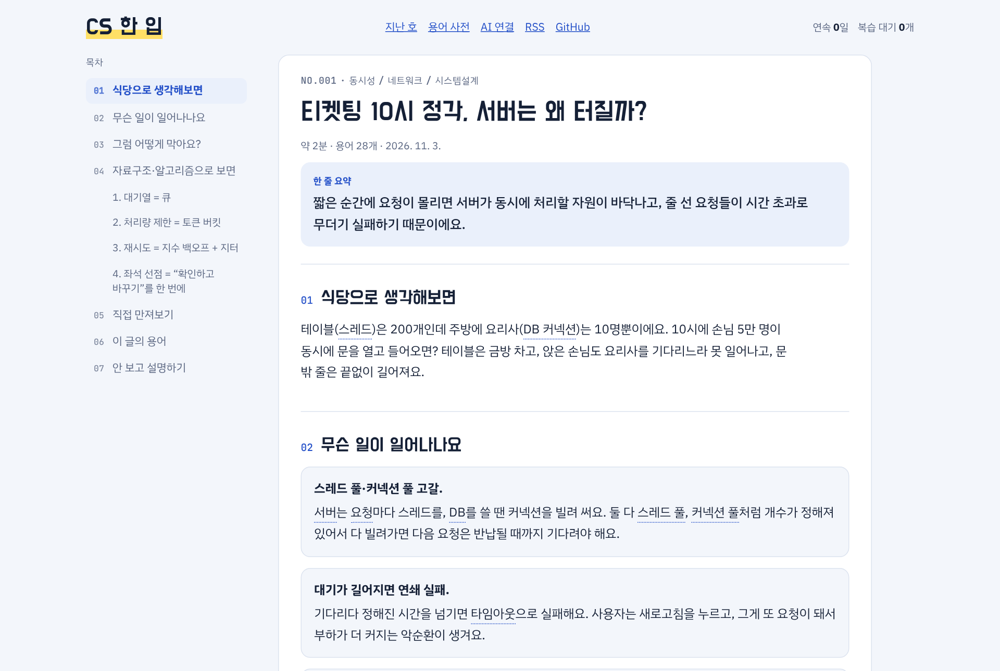
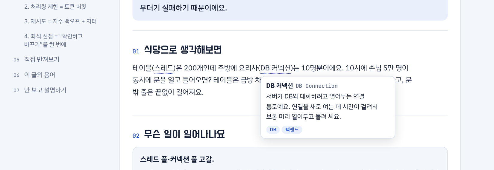
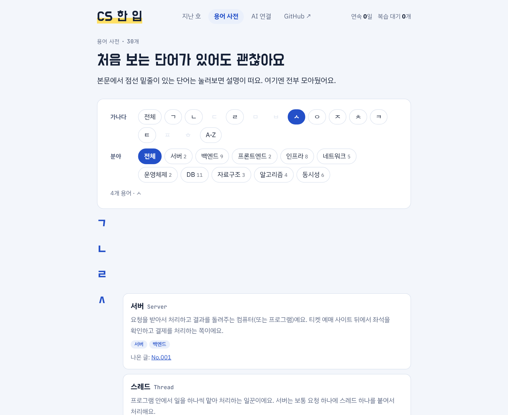
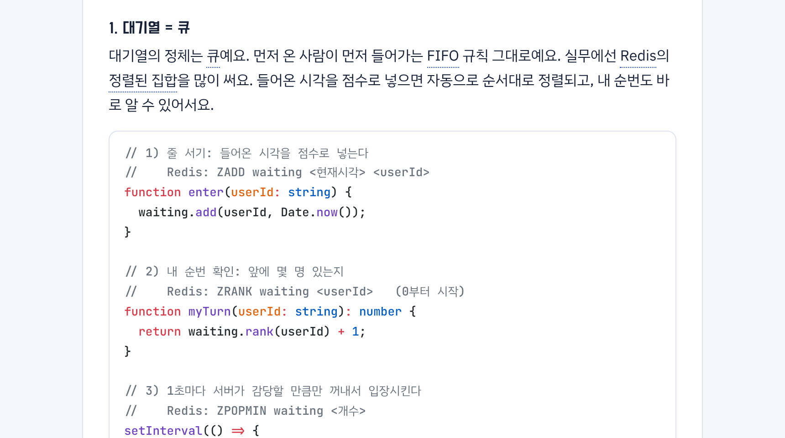
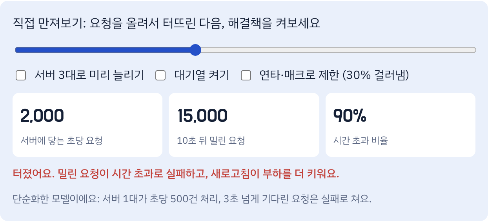
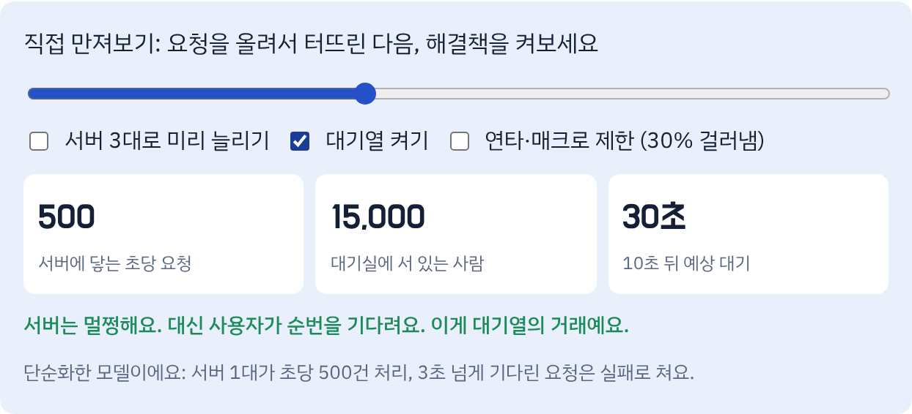
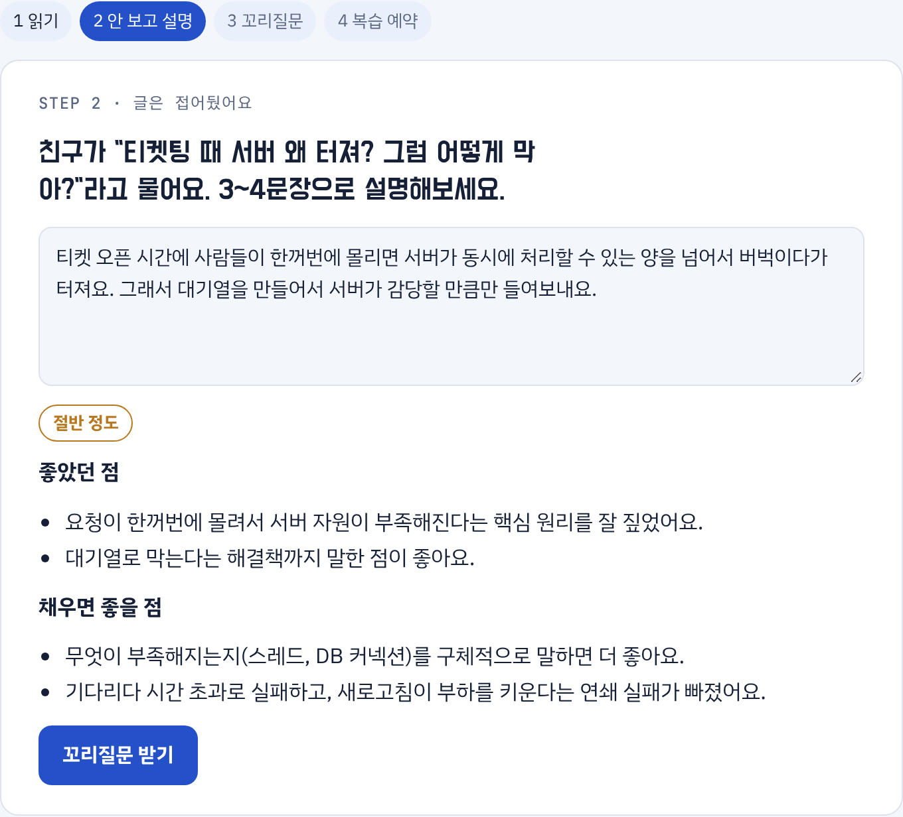
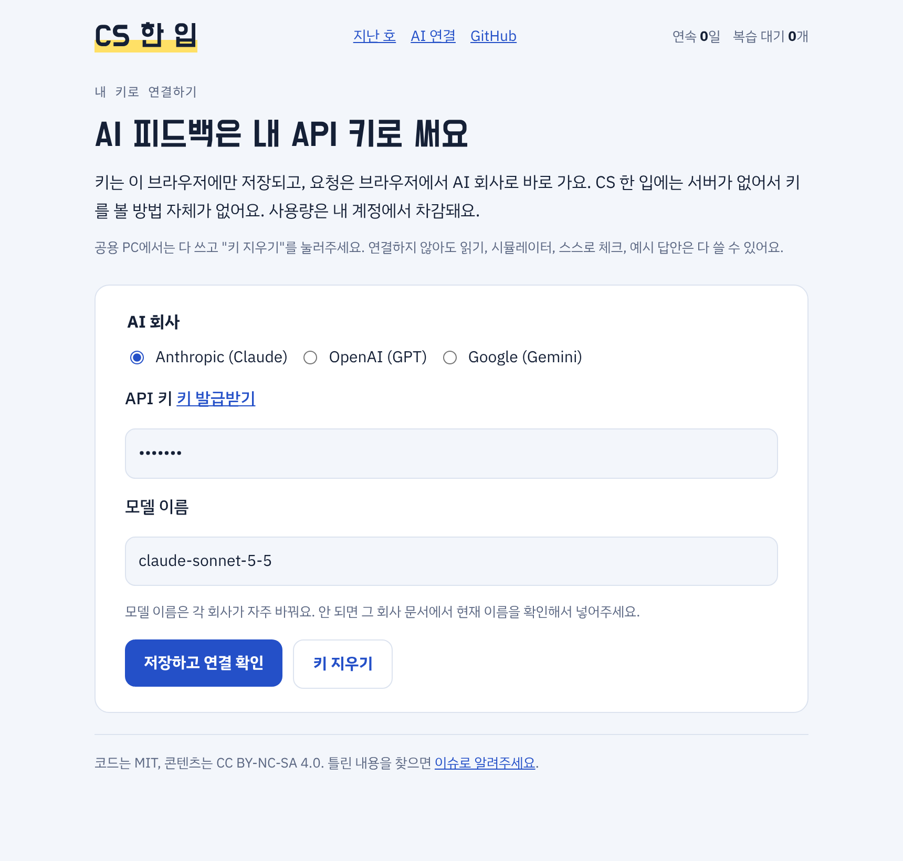

# CS 한 입

> 매일 5분, 읽고 꺼내고 다시. 외운 답 말고, 설명할 수 있는 답.

CS 면접 준비는 보통 "질문 → 정답 외우기"로 끝나요. 그런데 면접에서 떨어지는 이유는 대개 **꼬리질문에서 외운 티가 나서**예요.

CS 한 입은 한 호마다 이 흐름으로 공부해요.

1. **읽기**: 실제 사례(티켓팅 서버 폭주, 서비스 장애 등)로 개념을 읽어요. 원인, 해결 방법, 그리고 그 해결 방법이 어떤 자료구조·알고리즘인지까지. 모르는 단어는 눌러보면 설명이 떠요.
2. **만져보기**: 시뮬레이터로 숫자를 바꿔보며 원리를 확인해요.
3. **안 보고 설명하기**: 글을 접고 내 말로 설명해요. 읽기보다 떠올리기가 훨씬 오래 남아요.
4. **꼬리질문**: 면접관이 이어서 물을 법한 질문에 답해요.
5. **복습 예약**: 잘했으면 7일, 절반이면 3일, 못했으면 내일 다시 나와요.

## 미리보기

### 읽기: 목차 따라, 비유부터



왼쪽 목차는 스크롤을 따라오면서 지금 읽는 섹션을 표시하고, 누르면 바로 이동해요. 폰에선 위쪽에 접히는 목차로 바뀌어요.

### 모르는 단어는 눌러보기



### 용어 사전: 가나다·분야로 찾기



모든 용어에 분야 태그(서버, 백엔드, 프론트엔드, 인프라, 네트워크, 운영체제, DB, 자료구조, 알고리즘, 동시성, 보안)가 붙어 있고, 각 용어가 나온 글로 바로 갈 수 있어요.

### 해결 방법은 자료구조·알고리즘까지



### 만져보기: 터뜨린 다음 해결책 켜보기

| 요청 폭주 | 대기열을 켜면 |
|---|---|
|  |  |

### 안 보고 설명하기: AI가 빠진 부분을 짚어줘요



<sub>위 피드백은 화면 예시용 응답이에요. 실제 내용은 연결한 AI와 내 답변에 따라 달라져요.</sub>

### 내 키로 연결



## AI 피드백은 내 키로

설명 채점과 꼬리질문은 **각자 자기 API 키를 연결**해서 써요 (Anthropic, OpenAI, Google 지원).

- 키는 내 브라우저(localStorage)에만 저장돼요.
- 요청은 브라우저에서 AI 회사로 바로 가요. 이 사이트엔 서버가 없어서 키를 볼 방법 자체가 없어요.
- 연결하지 않아도 읽기, 시뮬레이터, 스스로 체크, 예시 답안은 전부 쓸 수 있어요.

## 로컬에서 실행

```bash
npm install
npm run dev     # http://localhost:4321/cs-hanip/
npm run build   # 콘텐츠 스키마 검사 + 정적 빌드
```

## 폴더 구조

```
content/issues/          뉴스레터 한 호 = 마크다운 파일 하나  ← 기여는 대부분 여기
content/glossary.yml     용어 사전 (본문의 [[용어]] 툴팁)
templates/               새 호 템플릿
src/
  content.config.ts      콘텐츠 스키마 (frontmatter 검사)
  lib/ai/                BYOK AI 연결 (Anthropic / OpenAI / Gemini 어댑터)
  lib/prompts.ts         채점·꼬리질문 프롬프트
  lib/progress.ts        연속 일수, 복습 일정 (브라우저 저장)
  lib/glossary.mjs       [[용어]] → 툴팁 변환, 사전에 없으면 빌드 실패
  components/            React 컴포넌트 (학습 흐름, AI 설정)
  components/sims/       호별 인터랙티브 시뮬레이터
  pages/                 Astro 페이지
.github/                 CI, 배포, 이슈·PR 템플릿
docs/ARCHITECTURE.md     설계 결정과 이유
docs/images/             README 스크린샷
```

## 기여하기

새 호 쓰기, 틀린 내용 고치기, 시뮬레이터 만들기, 프롬프트 개선 모두 환영해요. [CONTRIBUTING.md](CONTRIBUTING.md)를 먼저 읽어주세요.

## 라이선스

- 코드: [MIT](LICENSE)
- 콘텐츠(`content/` 아래 글): [CC BY-NC-SA 4.0](LICENSE-CONTENT.md). 출처를 밝히면 자유롭게 공유·수정할 수 있지만, 상업적으로 쓸 수 없고 수정본도 같은 조건으로 공개해야 해요.
